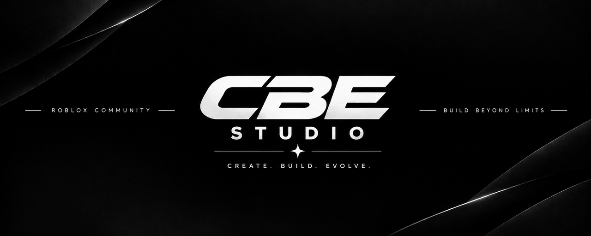

  

  

<h3 align="center">Roblox experience developer & DataStore migration tools</h3>

  
  
  
  

---

## About me

Hi, I'm **CBE-STUDIO** — a Roblox game developer who builds experiences and the
tools behind them. My focus is making developer life easier: **safe data
migration**, backups, and automation around the Roblox Open Cloud platform.

I believe every game deserves a clean handover to its next version — no lost
progress, no broken saves.

---

## My projects

### [Roblox DataStore Migration Toolkit](https://github.com/CBE-STUDIO/roblox-datastore-migration)

  
  

Move all your players' saved data from one Roblox experience to another —
safely, without losing anything, without touching the old game, and with a full
backup first. Written for beginners: copy-paste and run.

More tools are on the way (an interactive terminal-UI migrator is in the works).

---

## What I work with

* **Roblox Studio** — Luau scripting, DataStores, game systems
* **Open Cloud API** — DataStore read/write, automation
* **Python** — terminals, automation and migration tooling
* **Git / GitHub** — clean repos, documentation and open (and private!) source

---

## Find me

* GitHub: [@CBE-STUDIO](https://github.com/CBE-STUDIO)
* My tools: [roblox-datastore-migration](https://github.com/CBE-STUDIO/roblox-datastore-migration)

---

  

  Made with care by <b>CBE-STUDIO</b>

