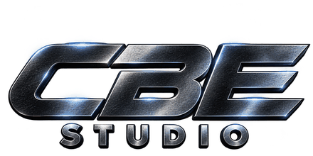

  

<h3 align="center">CBE-STUDIO</h3>

  <em>Roblox experience developer &amp; data tools</em>

  

---

## About me

Hi, I'm **CBE-STUDIO** — a Roblox game developer who builds experiences and the
tools behind them. My focus is making developer life easier: safe data
migration, backups, and automation around the Roblox Open Cloud platform.

I believe every game deserves a clean handover to its next version — no lost
progress, no broken saves.

---

## What I work with

* **Roblox Studio** — Luau scripting, DataStores, game systems
* **Open Cloud API** — DataStore read/write, automation
* **Python** — terminals, automation and migration tooling
* **Git / GitHub** — clean repos, documentation and open source

---

## Find me

* GitHub: [@CBE-STUDIO](https://github.com/CBE-STUDIO)

---

  

  made by <b>CBE-STUDIO</b>

